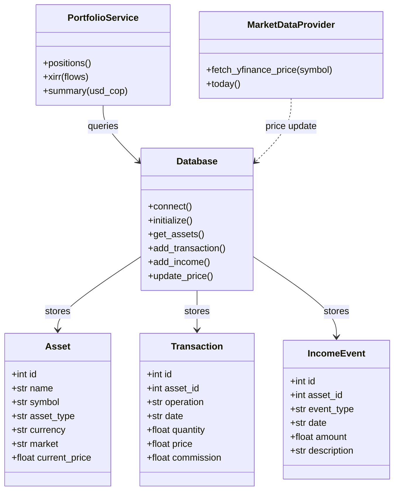
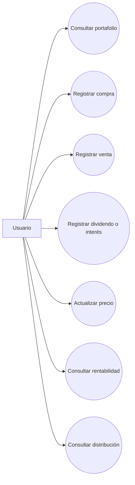
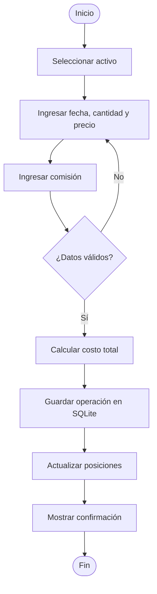

# Diagramas UML

Los diagramas se escriben en Mermaid. GitHub puede mostrar diagramas Mermaid en archivos Markdown.

## 1. Diagrama de clases

## 2. Diagrama de casos de uso

## 3. Flujo de compra

## Nota de mantenimiento

Si se modifican las clases o responsabilidades del código, actualizar este documento para que el UML siga coincidiendo con la implementación.
